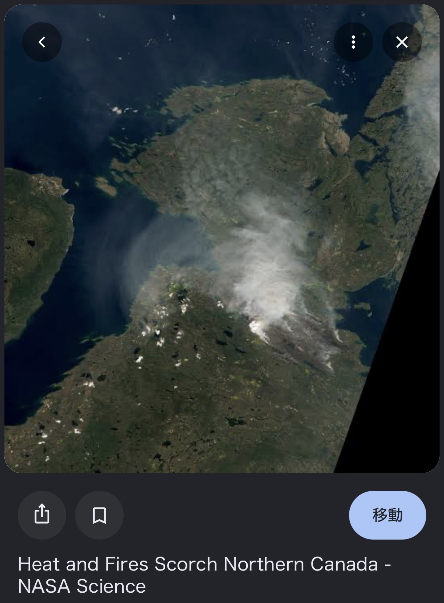

## PANTS_ON_FIRE

100

.nerdsmith

I found this screenshot from sometime in the past year when clearing out my screenshots folder, any chance you can tell me the name of the body of water?

P.S. Use all lowercase for the flag, and replace spaces with dashes.

## Solution 

画像検索したら似た地形がヒットした。




島位置が一致するのでこれかな


## Flag

```
wctf{great-bear-lake}
```